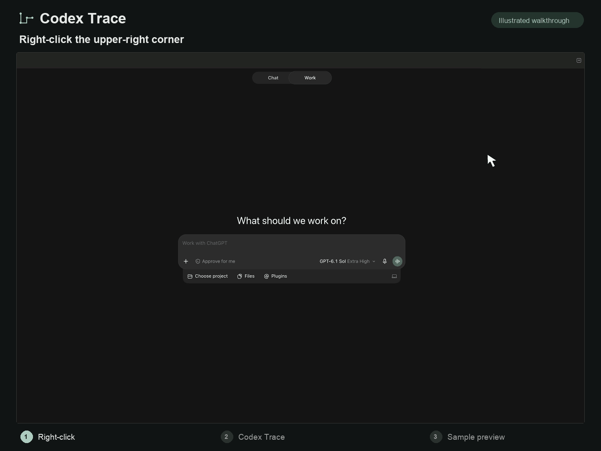
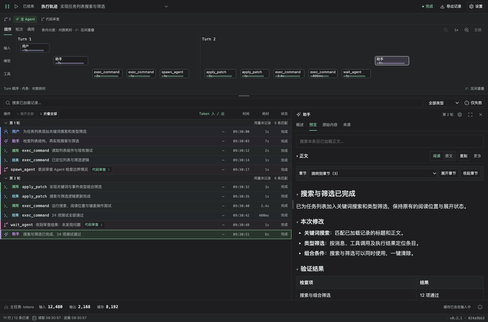
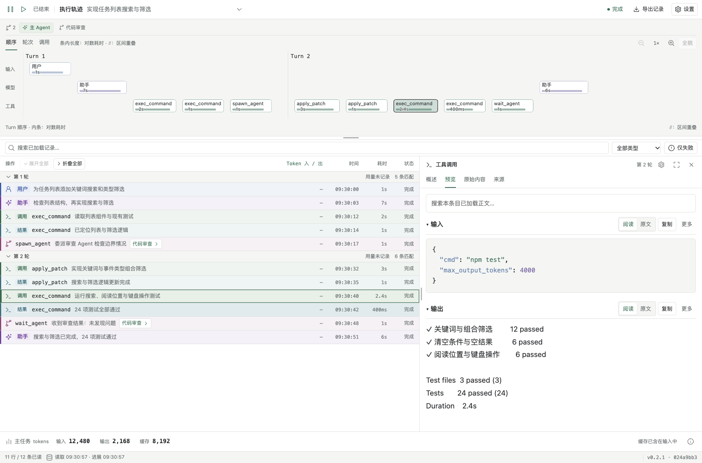

# Codex Trace

[English](README.md) | [简体中文](README.zh-CN.md)

View the execution traces of local Codex tasks, inspect model and tool inputs and outputs, follow child agents, and export verifiable raw records.

Codex Trace runs through a local Python MCP service and a bundled React interface. After installation, open the panel from **New Tab → Codex Trace** in a chat. If the current task cannot be identified, a task picker appears. The global entry point also asks you to select a task first.

[Community installation](INSTALL.md#community-marketplace-installation) · [Optional release assets](https://github.com/sirius0414/codex-trace/releases) · [Installation guide](INSTALL.md) · [Windows guide](WINDOWS.md) · [Contributing](CONTRIBUTING.md)

## Quick start

Install Git, uv, and Codex CLI 0.153.0 or a later compatible version. This public repository can be installed without GitHub credentials.

```sh
uv run --no-project --no-config --python 3.14.2 https://raw.githubusercontent.com/sirius0414/codex-trace/v0.2.2/install_community.py
```

The command prepares dependencies and checks startup automatically. After `"ready": true`, open **New Tab → Codex Trace**. If Codex was already running, start a new chat or restart it to load the plugin. No separate warmup is needed.

## Preview

Right-click in the upper-right corner of Codex, then select **Codex Trace** from the menu. The animation follows a reference screenshot, uses the English plugin name, and shows sample task data in the final preview.



The current interface with sample task data: execution overview, agent navigation, event list, and record details.



<details>
<summary>Inspect tool inputs and outputs</summary>



</details>

## Features

- **Inspect execution:** browse messages, tool calls, inputs, and outputs by turn, with summaries and raw records.
- **Find relevant content:** search, filter, expand details, and zoom, pan, or locate entries in the execution overview. Search and filters apply to loaded records; earlier history can be loaded separately.
- **Follow agents:** the main agent and confirmed child agents have separate pages, with navigation through creation and communication records.
- **Observe progress:** continuously read new records, pause observation, and restore your reading position. Pausing the viewer does not pause the agent.
- **Review usage and export:** display token usage with explicit source evidence, and export raw records for the current task and confirmed child tasks as a ZIP with a source manifest and SHA-256 hashes.

The interface reports only the timing, usage, relationships, and states supported by the records. Missing information is marked explicitly; unknown stages or task completion states are not inferred. The execution overview is arranged by turn, and visual distance does not represent actual elapsed time.

## Supported platforms

| Item | Requirements and boundaries |
| --- | --- |
| macOS | A local Codex desktop application and a working companion CLI |
| Windows | Windows 10/11, native Codex, and local NTFS volumes; no WSL required |
| Python | The community marketplace uses uv-managed Python 3.14.2; optional installer/source workflows need local Python 3.14+ |
| Codex CLI | 0.153.0 or a later compatible version, supporting `plugin marketplace`, `plugin add/remove`, and the required read-only app-server APIs |
| Git / uv | Git is required to register the community marketplace; uv must be discoverable through the Codex process's PATH |
| Network | GitHub access for registration and updates; uv obtains Python and locked dependencies during initial preparation, dependency changes, or cache misses |

Community users do not need Node.js, a manual source checkout, or a frontend build; Git and uv are prerequisites. The optional installer's prerequisites are described separately. Linux, WSL, cloud execution, and data directories on Windows network volumes, UNC paths, or reparse points are outside the current support scope.

Windows has a native implementation and a CI validation workflow. Whether a particular version has passed native testing must be determined from that version's CI reports and desktop acceptance results; macOS tests are not a substitute. See [Windows support and acceptance](WINDOWS.md) for detailed boundaries.

## Install, update, and uninstall

Community distribution installs `codex-trace` from this public GitHub repository's `codex-trace-community` marketplace without GitHub credentials. Install **Git, uv, and Codex CLI 0.153.0 or a later compatible version**. Node.js, a manual source checkout, and a frontend build are unnecessary. See [INSTALL.md](INSTALL.md) for installation, network, and cache details, and [MARKETPLACE.md](MARKETPLACE.md) for the maintainer workflow.

### First community installation

Run the complete command in [Quick start](#quick-start). The installer pins the matching Release tag, prepares Python and locked dependencies, and checks the actual MCP service and UI resources offline before reporting readiness. No Node.js, manual build, or separate warmup is needed. Initial downloads require network access; uv manages runtime and caches outside the plugin directory.

Start a new chat or restart an already-running Codex, then open **New Tab → Codex Trace**. Retain original requests for pending exports. This user-installed GitHub marketplace is separate from OpenAI public-directory review.

### Community update and uninstall

Run the complete command from the latest [installation guide](INSTALL.md#community-marketplace-update) to switch to its Release tag and prepare dependencies automatically. Uninstall the plugin and remove the marketplace with:

```sh
codex plugin remove codex-trace@codex-trace-community
codex plugin marketplace remove codex-trace-community
```

Removal does not automatically delete derived indexes, reading preferences, export receipts, final ZIPs, or uv's shared caches. Reconcile pending exports, stop the plugin service, and close its pages before cleaning data. See the [privacy and cleanup notice](PRIVACY.md).

### Optional installation formats

For a separate installer, follow the [release ZIP installer workflow](INSTALL.md#optional-release-zip-installer) using `codex-trace-0.2.2.zip` and its checksums. It requires local Python and registers the `codex-trace` marketplace. Maintainers can also build [platform-specific offline candidates with bundled runtimes](MARKETPLACE.md#optional-native-offline-plugin-package). Do not enable the community, installer, and development copies of the same plugin simultaneously. Download availability and actual publication status are shown in [GitHub Releases](https://github.com/sirius0414/codex-trace/releases).

## Data and exports

Codex Trace observes saved Codex task records in read-only mode. It does not create, continue, or interrupt tasks through app-server. Indexes, reading preferences, and export receipts are stored in the plugin's own directory; final exports are saved under Downloads.

| Data | Default macOS location | Default Windows location |
| --- | --- | --- |
| Codex source | `~/.codex` | `%USERPROFILE%\.codex` |
| Optional installer records and isolated environments | `~/.local/share/codex-trace/installations/<id>/` | `%LOCALAPPDATA%\codex-trace\installations\<id>\` |
| Indexes, preferences, and receipts | `~/.local/share/codex-trace/index/` | `%LOCALAPPDATA%\codex-trace\index\` |
| Final exports | `~/Downloads/Codex Trace/` | `%USERPROFILE%\Downloads\Codex Trace\` |

`CODEX_HOME` can select the Codex source; the optional installer derives its directory identifier from that path. Codex caches the community plugin program, while uv manages Python and dependencies externally. Do not move a runtime environment that is in use.

Exports independently enumerate known sources for the current task and its confirmed child tasks. Search, filters, collapsed sections, and pagination on the current page do not reduce the export scope. The ZIP manifest records sources, collection ranges, hashes, and missing portions. Unknown types and incomplete raw lines are retained by source. Multiple files belonging to an active task may be collected at different times, so a successful save does not imply complete source data.

A save is confirmed only when the interface displays “Local export verified” and an actual path. If a wait times out or the result is unconfirmed, check the original request rather than creating duplicate exports. Exports may contain private task content; review them before sharing.

## Build and verification

These steps are for contributors and maintainers. Install Python 3.14+, Node.js/npm, and the Codex CLI. CI uses Node.js 24 and Python 3.14. The development environment and the end-user installation environment are managed separately.

### Prepare the development environment

```sh
git clone https://github.com/sirius0414/codex-trace.git
cd codex-trace
```

**macOS:**

```sh
python3.14 -m venv .venv
.venv/bin/python -m pip install -r requirements.lock
npm ci
npm run build
npm test
PYTHONPATH=backend:tests .venv/bin/python -m unittest discover -s tests -v
.venv/bin/python contracts/generate_types.py --check
```

**Windows PowerShell:**

```powershell
py -3.14 -m venv .venv
& .\.venv\Scripts\python.exe -m pip install -r requirements.lock
npm ci
npm run build
npm test
$env:PYTHONUTF8 = "1"
$env:PYTHONPATH = "backend;tests"
& .\.venv\Scripts\python.exe -m unittest discover -s tests -v
& .\.venv\Scripts\python.exe contracts/generate_types.py --check
```

Python dependencies are locked by `requirements.lock`, including `pywin32`, which is installed only on Windows. Frontend dependencies are locked by `package-lock.json`. Python entry points invoked through npm prefer the interpreter specified by `CODEX_TRACE_PYTHON` or the repository's `.venv`.

### Browser debugging

```sh
npm run dev:browser:start
npm run dev:browser:status
npm run dev:browser:stop
```

After startup, open the local `file://` entry file printed by the command. `status` can show the entry again. The file is readable only by the current OS user and passes startup credentials to the page through a URL fragment, which is not sent over HTTP. Visiting `http://localhost:8765/` directly does not provide credentials. Reopen the entry file after restarting the service. Refreshing the same tab retains credentials; do not share the entry file. This entry uses the production frontend and backend, follows `CODEX_HOME` for its task source, reads local Codex records by default, and listens only on `127.0.0.1`. Debug indexes, logs, and exports are stored under `build/dev-browser/`.

After frontend changes, run `npm run build` and refresh the page. After backend changes, run `npm run dev:browser:restart`. You can also use `npm run dev:browser` to run in the foreground. To specify the environment:

```sh
npm run dev:browser:start -- --port 8766 --python /path/to/python --codex /path/to/codex
```

### Updating the development plugin from source

With the locked dependency environment already prepared, first prepare and inspect a local development package:

```sh
npm run plugin:update -- --prepare-only
```

Review the verification results in the output directory, then replace the example directory below with the actual directory:

```sh
npm run plugin:update -- --install-prepared build/update-ACTUAL_DIRECTORY
```

This workflow uses `codex-trace@codex-trace-local`; its generated package is bound to local runtime paths. Use the release build in the next section for distribution to other users. See [WINDOWS.md](WINDOWS.md) for the native Windows development workflow.

## Release workflow

See [MARKETPLACE.md](MARKETPLACE.md) for community repository generation, verification, and release. The following optional release ZIP installer workflow is retained; its presence does not mean that a corresponding version has been published.

### Build an installer

After preparing the development environment, run:

```sh
npm run release:build
```

You can also run `scripts/build_release.py` directly with Python. The default output is:

```text
build/releases/
├── codex-trace-0.2.2.zip
└── SHA256SUMS
```

The build compiles the frontend, checks version consistency and the license inventory, includes allowlisted installer files, the built interface, backend, contracts, dependency lockfiles, and licenses, and generates a per-file checksum manifest inside the package. Development environments, Codex configuration, credentials, sessions, indexes, and exports are excluded.

Versions must match across `package.json`, `package-lock.json`, the plugin manifest, and the backend's `__version__`. Release builds default to `SOURCE_DATE_EPOCH=0` and fixed ZIP metadata. Identical source, dependencies, toolchains, and time values produce byte-identical artifacts. The build refuses to overwrite an existing artifact of the same version with different content; update the version for a new release. After dependency updates, refresh the [third-party license snapshot](third_party/README.md).

### Verify the installer

First build again in a separate directory and compare the SHA-256 hashes of the two ZIPs for the same version:

```sh
npm run release:build -- --output build/reproduce
```

Then run installation verification. The script uses a real Codex CLI, a new Python environment, and locked dependencies in a temporary user directory. It checks first installation, repeated installation, updates, failure recovery, MCP/export behavior, and uninstallation. On macOS:

```sh
.venv/bin/python scripts/smoke_release.py \
  --archive build/releases/codex-trace-0.2.2.zip \
  --report build/release-smoke.json
```

On Windows, use `& .\.venv\Scripts\python.exe scripts/smoke_release.py --archive build/releases/codex-trace-0.2.2.zip --report build/release-smoke.json`. Add `--codex` to specify a CLI. For offline testing, provide previously downloaded dependencies with `--wheelhouse DIR`. Verification does not read real sessions or modify real plugin configuration, but CLI/MCP tests do not replace manual acceptance of the desktop entry point.

### GitHub Release

The [Release workflow](https://github.com/sirius0414/codex-trace/blob/main/.github/workflows/release.yml) installs dependencies, runs tests, checks contracts, builds twice and compares artifacts, then verifies the extracted package's installation lifecycle separately on macOS and Windows.

| Trigger | Result |
| --- | --- |
| Any pull request or a push to `main` | Validate and retain build artifacts and installation reports |
| Manual `workflow_dispatch` on a branch | Validate and retain artifacts without creating a release |
| A `v*` tag matching the manifest version | After validation, create or update a draft release with the installer ZIP and checksums |

Manually running the workflow on a `v*` tag also runs the draft-release step. Maintainers review platform reports, desktop acceptance results, and known limitations before publishing the draft. The workflow neither overwrites a published release nor lists the plugin in OpenAI's public plugin directory. Having a release workflow in the repository does not mean a particular version has been published.

## Documentation and contributing

Conventional filenames contain English documentation; `*.zh-CN.md` files contain Simplified Chinese versions. When editing documentation, update both languages' steps, commands, support boundaries, and links in the same change.

| Document | Contents |
| --- | --- |
| [INSTALL.md](INSTALL.md) | Community installation and updates, optional installer, and troubleshooting |
| [MARKETPLACE.md](MARKETPLACE.md) | Community repository release, optional native offline packages, and validation boundaries |
| [PRIVACY.md](PRIVACY.md), [TERMS.md](TERMS.md), [SUPPORT.md](SUPPORT.md) | Data access and storage, license boundaries, and support channels |
| [WINDOWS.md](WINDOWS.md) | Native Windows implementation, filesystem boundaries, and acceptance procedures |
| [CONTRIBUTING.md](CONTRIBUTING.md) | Development constraints, coding conventions, and review entry points |
| [SECURITY.md](SECURITY.md) | Security support scope and private vulnerability reporting |
| [contracts/README.md](contracts/README.md) | MCP data contracts and export semantics |
| [third_party/README.md](third_party/README.md) | Maintaining cross-platform dependency license snapshots |

Report ordinary issues and improvement suggestions through [GitHub Issues](https://github.com/sirius0414/codex-trace/issues), including OS and Python/Codex versions, reproduction steps, and an error summary with personal information removed. Report security or privacy vulnerabilities privately according to the [security policy](SECURITY.md).

## License

The project's own code uses the [MIT License](LICENSE). A [Chinese license translation](LICENSE.zh-CN.md) is available for reference; the English license text governs. Third-party components retain their respective license terms, and their full texts are included in release packages. See the [third-party notices](https://github.com/sirius0414/codex-trace/blob/main/third_party/THIRD_PARTY_NOTICES.txt) and [LICENSES](https://github.com/sirius0414/codex-trace/tree/main/third_party/LICENSES/).
